# Linh Anh Website — Execution Plan

## Context and impact

Approved inputs: Linh Anh website requirements, eight reader-journey stories and three personas. Existing architecture, component inventory, stack and dependencies were reviewed. Saved clarification choices are 1A, 2B and 3C.

This is a broad public-facing replacement within one React/TypeScript/Vite package. Retain static GitHub Pages hosting and build tooling. Replace inherited portfolio identity, section presentation, navigation and public metadata. Content organisation and components will change; no database schema, service API or infrastructure change is needed.

Risk: medium. Main risks are unsupported claims from application evidence, publishing unrelated/private assets, inherited routes or metadata remaining visible, and mobile/accessibility regressions. Rollback is straightforward through version control; source documents and historical audit records must be preserved. Verification complexity is moderate.

## Component relationships

- Primary: React entry and App — major public-experience replacement, critical.
- Content: typed profile, project, research, experience and achievement data — major replacement, critical; depends on source-document inspection.
- Presentation: portfolio shell, navigation, section components and CSS — major replacement, critical; depends on approved content and design.
- Supporting: resume/evidence assets, metadata and public directory — selective replacement and cleanup, critical; must exclude inherited identity from the build.
- Verification: navigation, downloads, dates/statuses and content regression checks — update to the new public contract, important. Remove or adapt tests only where their retired feature contracts no longer apply; preserve useful shared-tool checks.
- Infrastructure: existing Vite base-path handling and Pages workflow — reuse; no hosting migration.

## Stage decisions and depth

- [x] Workspace Detection — completed.
- [x] Reverse Engineering — existing static application architecture reviewed and reused.
- [x] Requirements Analysis — approved, standard depth.
- [x] User Stories — eight stories and three personas approved.
- [x] Workflow Planning — execution plan prepared.
- [x] Workflow Planning approval — user: “approve”.
- [x] Application Design — EXECUTE, minimal depth: define the replacement shell, section/data boundaries, navigation state and asset responsibilities.
- Units Generation — SKIP: one cohesive static portfolio unit; no separate packages or services.
- Functional Design — SKIP: presentation content and simple navigation; no complex business rules, new domain schema or algorithms. Content types belong in application/code planning.
- [x] NFR Requirements — EXECUTE, minimal depth: define concrete accessibility, responsive, performance and source-publication checks using the existing stack.
- [x] NFR Design — EXECUTE, minimal depth: map those checks to styles, motion, navigation and asset handling.
- Infrastructure Design — SKIP: existing GitHub Pages deployment is sufficient.
- [x] Code Generation Part 1 — EXECUTE: prepare explicit implementation steps and obtain plan approval.
- [x] Code Generation Part 2 — EXECUTE: inspect relevant evidence, implement the approved plan, update checkboxes and present the working result for review.
- [x] Build and Test — EXECUTE: complete relevant verification and required build/test documentation after implementation review.
- Operations — PLACEHOLDER: acknowledge at the final handoff. Publication remains a later action.

## Workflow visualization

```mermaid
flowchart TD
    WD["Workspace Detection - COMPLETE"]
    RE["Reverse Engineering - REUSED"]
    RA["Requirements - APPROVED"]
    US["User Stories - APPROVED"]
    WP["Workflow Planning - REVIEW"]
    AD["Application Design - EXECUTE"]
    UG["Units Generation - SKIP"]
    FD["Functional Design - SKIP"]
    NR["NFR Requirements - EXECUTE"]
    ND["NFR Design - EXECUTE"]
    ID["Infrastructure Design - SKIP"]
    CG["Code Generation - EXECUTE"]
    BT["Build and Test - EXECUTE"]
    OP["Operations - PLACEHOLDER"]
    WD --> RE
    RE --> RA
    RA --> US
    US --> WP
    WP --> AD
    AD --> UG
    UG --> FD
    FD --> NR
    NR --> ND
    ND --> ID
    ID --> CG
    CG --> BT
    BT --> OP
    style WD fill:#4CAF50,stroke:#1B5E20,stroke-width:3px,color:#fff
    style RE fill:#4CAF50,stroke:#1B5E20,stroke-width:3px,color:#fff
    style RA fill:#4CAF50,stroke:#1B5E20,stroke-width:3px,color:#fff
    style US fill:#4CAF50,stroke:#1B5E20,stroke-width:3px,color:#fff
    style WP fill:#4CAF50,stroke:#1B5E20,stroke-width:3px,color:#fff
    style AD fill:#FFA726,stroke:#E65100,stroke-width:3px,stroke-dasharray: 5 5,color:#000
    style UG fill:#BDBDBD,stroke:#424242,stroke-width:2px,stroke-dasharray: 5 5,color:#000
    style FD fill:#BDBDBD,stroke:#424242,stroke-width:2px,stroke-dasharray: 5 5,color:#000
    style NR fill:#FFA726,stroke:#E65100,stroke-width:3px,stroke-dasharray: 5 5,color:#000
    style ND fill:#FFA726,stroke:#E65100,stroke-width:3px,stroke-dasharray: 5 5,color:#000
    style ID fill:#BDBDBD,stroke:#424242,stroke-width:2px,stroke-dasharray: 5 5,color:#000
    style CG fill:#4CAF50,stroke:#1B5E20,stroke-width:3px,color:#fff
    style BT fill:#4CAF50,stroke:#1B5E20,stroke-width:3px,color:#fff
    style OP fill:#BDBDBD,stroke:#424242,stroke-width:2px,stroke-dasharray: 5 5,color:#000
    linkStyle default stroke:#333,stroke-width:2px
```

Text alternative: completed workspace review, reused architecture, approved requirements and approved stories lead to execution-plan approval. Then Application Design, minimal NFR Requirements and NFR Design lead to Code Generation planning/approval and implementation/review, followed by Build and Test and the Operations placeholder. Units Generation, Functional Design and Infrastructure Design are skipped for the reasons above.

Diagram validation: identifiers, quoted labels and edge endpoints checked against the generated flowchart grammar before writing; no external Mermaid rendering check performed. The text alternative is authoritative if rendering is unavailable.

## Single-package change sequence

1. Inspect relevant source documents and suitable images; document extracted content, source mappings and any discrepancies. Preserve originals and avoid publishing the full archive.
2. Define component/data boundaries and the yellow, ink and cream visual system with subtle bee details.
3. Set measurable responsive/accessibility and asset-delivery checks in the NFR stages.
4. In the approved code plan, implement source-backed content, section navigation, project/research evidence, resume/contact and responsive styling.
5. Replace public entry points and metadata; audit old public assets, inherited routes and generated output for unrelated identity.
6. Verify build, meaningful interactions and content accuracy; perform browser visual checks where supported and document limits.

This is one sequential unit, with no cross-package coordination or delegated-agent work required. Keep application code at the workspace root and workflow records in aidlc-docs.

## Success and quality gates

- All eight user stories have satisfied acceptance criteria or explicitly documented unresolved checks.
- The site presents Linh Anh’s student identity, analytical interests and supported contributions accurately, including pending/planned achievements.
- Yellow background and bee references form a coherent, readable desktop and mobile design.
- Navigation, evidence, resume and email actions work; relevant automated checks and the production build pass.
- Public output contains no inherited person’s identity or unrelated/private application files.
- Stage approvals follow AI-DLC; completed plan steps and stage state are updated in the same interaction.

## Effort and scope control

One portfolio unit remains, with five execution stages: Application Design, NFR Requirements, NFR Design, Code Generation and Build and Test. Code Generation has separate planning and implementation reviews. Wall-clock duration depends on evidence quality and approval turnaround; no fixed delivery estimate is asserted.

## Extension compliance

- Security Baseline: N/A — disabled by approved answer 2B; full rules skipped.
- Property-Based Testing: N/A — disabled by approved answer 3C; full rules skipped.

## Review

The user may request changes or include skipped stages. Approval proceeds to Application Design; this plan does not approve future designs or implementation artifacts in advance.
